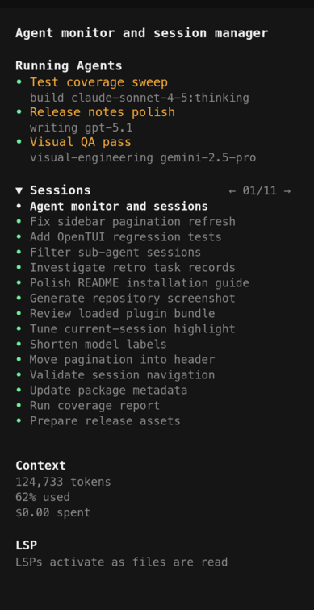

# opencode-sidebar-background-sessions

OpenCode TUI sidebar plugin for background agents and quick session navigation.

It adds two sidebar sections:

- `Running Agents` — shows active child-agent sessions and lets you jump into them.
- `Sessions` — a collapsible project-session accordion with paginated navigation between recent sessions.



## Features

- Tracks active child-agent sessions. On V2 this includes foreground and background subagents.
- Adds a project-only `Sessions` accordion.
- Supports click-to-open agent and session rows.
- Includes compact header pagination, for example `← 01/11 →`.
- Hides stale completed-agent records and sub-agent sessions from the navigator.
- On V2, shows session activity and attention indicators, including active child agents.

## Sidebar behavior

When background agents are active, the plugin renders `Running Agents` above the session navigator. Clicking a running-agent row navigates to that sub-agent session.

The `Sessions` accordion is always rendered. It starts collapsed as:

```text
▶ Sessions
```

When expanded, it renders session rows and pagination controls in the accordion header:

```text
▼ Sessions                                           ← 01/11 →
○ Idle project session
● Working project session
◆ Session with an unread result
? Session waiting for an answer
```

The arrows are always visible when sessions are loaded. Active arrows are bright; inactive arrows are muted. Clicking pagination controls changes the visible page without collapsing the accordion. In V2, the accordion stays open or closed when navigating between sessions.

### V2 activity indicators

| Indicator | Meaning |
| --- | --- |
| `○` muted | Idle |
| `●` blinking success color | Working |
| `!` warning color | Permission approval needed |
| `?` warning color | Answer needed |
| `◆` accent color | Unread completed or interrupted execution |
| `×` error color | Unread failed execution |
| `·` muted | Attention status loading or unavailable |

Colors follow the active OpenCode theme. A permission or question takes precedence over working, including requests from known child sessions. A root also shows working when a known child is active. Unread status follows OpenCode's server-side viewed timestamp for the root session, so viewing it clears the indicator. OpenCode does not expose a reliable percentage for session execution.

Only visible session rows and active child agents are checked for pending requests. Status updates follow OpenCode's live events. On reconnect the plugin refreshes those checks. Requests belonging to children not yet known to the client cannot be attributed to their parent.

To keep the working indicator steady instead of blinking, configure this plugin with `animate: false` in `cli.json`:

```jsonc
{
  "plugins": [
    { "package": "opencode-sidebar-background-sessions", "options": { "animate": false } }
  ]
}
```

Use the local package path instead of the name when using a development checkout. This option is separate from OpenCode's global animation setting. V1 keeps its existing indicators.

## Installation

### For Humans

Copy and paste this prompt to your LLM agent (OpenCode, Claude Code, AmpCode, Cursor, etc.):

```text
Install and configure the OpenCode TUI plugin `opencode-sidebar-background-sessions` by following the instructions here:
https://raw.githubusercontent.com/dnaroid/opencode-sidebar-background-sessions/master/docs/guide/installation.md
```

Or read the [Installation Guide](docs/guide/installation.md), but letting an agent edit the config is safer.

### For LLM Agents

Fetch the installation guide and follow it:

```bash
curl -s https://raw.githubusercontent.com/dnaroid/opencode-sidebar-background-sessions/master/docs/guide/installation.md
```

### OpenCode V2

V2 support requires a release containing this port. The published `0.5.0` package supports V1 only. Until a V2-compatible release is published, use the [local development install](#local-development-install).

Add the TUI-only package to `~/.config/opencode/cli.json` (or `$XDG_CONFIG_HOME/opencode/cli.json`):

```jsonc
{
  "$schema": "https://opencode.ai/v2/cli.json",
  "plugins": ["opencode-sidebar-background-sessions"]
}
```

Preserve existing entries in `plugins`. OpenCode reloads valid changes to `cli.json` automatically. The sidebar is visible in a session when the terminal is wide enough and the sidebar is enabled.

### OpenCode V1

Install the npm package into your OpenCode config directory:

```bash
cd ~/.config/opencode
bun add opencode-sidebar-background-sessions
```

- **macOS / Linux**: `~/.config/opencode/tui.json`
- **Windows**: `%APPDATA%\opencode\tui.json`

```jsonc
{
  "$schema": "https://opencode.ai/tui.json",
  "plugin": ["./node_modules/opencode-sidebar-background-sessions"],
}
```

Restart OpenCode after installing. The sidebar renders the `Sessions` accordion even when there are no running background agents.

Do not use `opencode plugin -g` for this package if your OpenCode version writes plugin entries to `opencode.json`; that command is for server plugins, while this package is loaded by the TUI plugin runtime.

### Updates

On V1, when installed from npm under `~/.config/opencode/node_modules`, the plugin checks npm on startup and updates itself with:

```bash
bun add opencode-sidebar-background-sessions@latest
```

The running OpenCode process keeps the old bundle in memory, so after an automatic update the sidebar shows a restart notice. Restart OpenCode to load the new version.

To disable automatic updates, start OpenCode with:

```bash
OPENCODE_SIDEBAR_BACKGROUND_SESSIONS_AUTO_UPDATE=0 opencode
```

V2 does not run the plugin's V1 self-updater. Update a package through OpenCode or rebuild a local checkout instead.

## Local development install

From this package directory:

```bash
bun install
bun run build
```

Then add the package root to your existing TUI configuration. OpenCode resolves the `./tui` export from `package.json`:

```jsonc
// V2: ~/.config/opencode/cli.json
{
  "plugins": ["/absolute/path/to/opencode-sidebar-background-sessions"]
}
```

```jsonc
// V1: ~/.config/opencode/tui.json (macOS/Linux)
// V1: %APPDATA%\opencode\tui.json (Windows)
{
  "plugin": ["/absolute/path/to/opencode-sidebar-background-sessions"],
}
```

Rebuild after changing the source. Use `/reload` in V2 if needed to load the rebuilt bundle. Keep other config entries unchanged.

## Development

```bash
bun install
bun run typecheck
bun run test
bun run test:coverage
bun run build
```

The test suite builds the plugin first and drives both TUI implementations through OpenTUI's `testRender` harness. It covers accordion interaction, project-scoped loading, pagination, navigation, activity and attention states, stale requests and cleanup. Run the V1 tests against OpenTUI 0.2 as well when changing shared runtime code.

## Notes

- This is a TUI plugin. Configure it in `cli.json` for V2 or `tui.json` for V1, not `opencode.json`.
- On V2, `Running Agents` reflects the live status of direct child sessions, not historical tool output.
- The plugin intentionally does not mutate session titles. It reads the current TUI session state and renders only in the sidebar.
